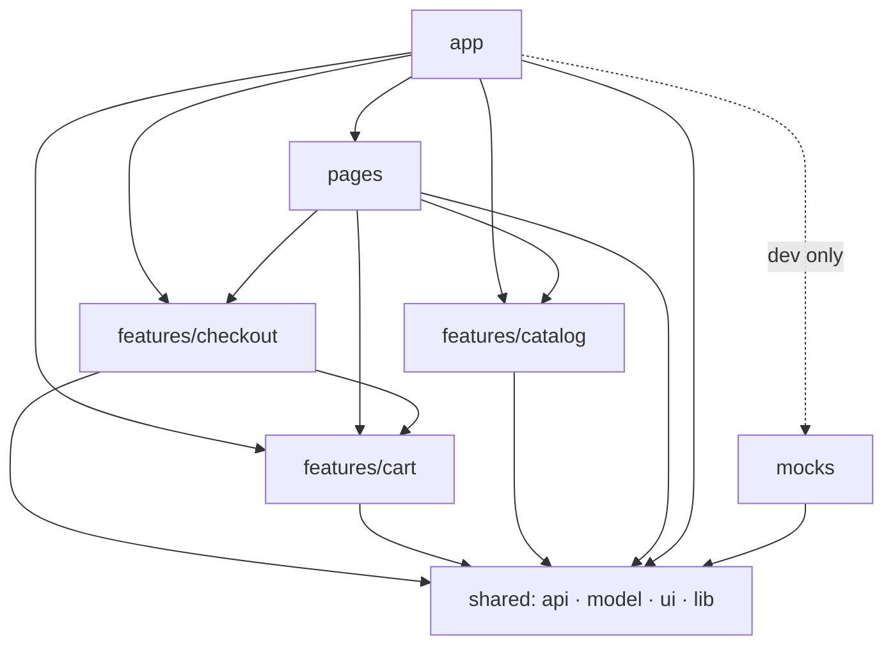
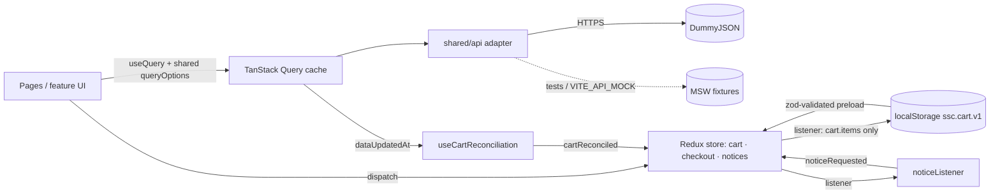
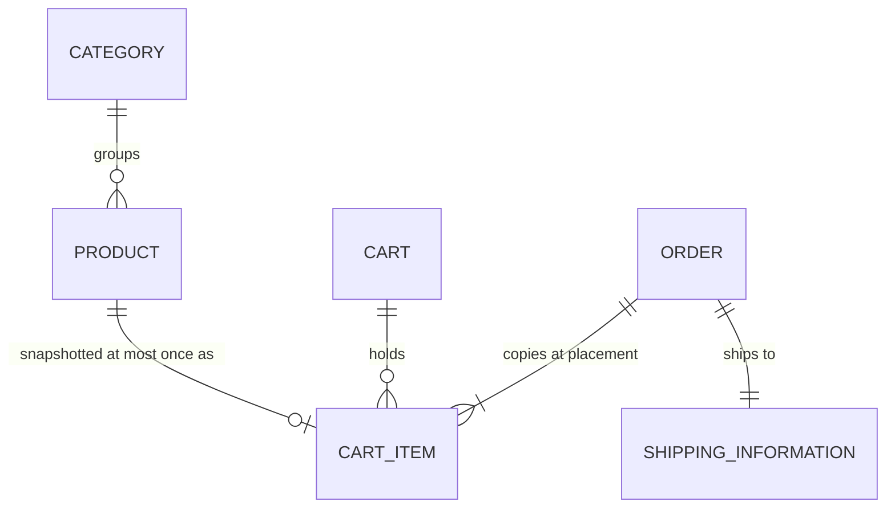

# Architecture Spine — Simple Shopping Cart

## Design Paradigm

**Feature modules over a shared layer, with dependencies flowing one way.** Each PRD feature group is one feature module. Pages compose features. Nothing below a layer imports from above it.

| Layer | Directory | Holds |
|---|---|---|
| app | `src/app/` | Bootstrap, providers, Redux store and listeners, route table, RootLayout, global error page |
| pages | `src/pages/` | One module per route; composes features; contains no business rules |
| features | `src/features/{catalog,cart,checkout}/` | Feature UI, hooks, Redux slices, and pure domain logic; public API through `index.ts` |
| shared | `src/shared/` | `api/` (Product API adapter, query options), `model/` (domain types, Money, shared events), `ui/` (design system, including the Notice slice), `lib/` (generic utilities) |
| mocks | `src/mocks/` | MSW handlers and fixtures, used by tests and by development only |



## Invariants & Rules

### AD-1 — One-way dependencies and feature public APIs [ADOPTED]

- **Binds:** all of `src/`; NFR-9, NFR-11
- **Prevents:** cart importing catalog internals (or the reverse), import cycles, and features scattered across folders by technical type
- **Rule:**
  - Imports may only follow the arrows in the diagram above.
  - Code outside a feature imports it only through its `index.ts`, never by deep path.
  - The only allowed import between features is `checkout → cart`. `catalog` and `cart` never import each other.
  - Pages combine UI from different features by composition. For example, `ProductCard` takes an `action` slot, and the page fills it with `cart`'s `AddToCartButton`.
  - `shared/` imports nothing from `features/`, `pages/`, `app/` or `mocks/`.
  - `mocks/` is imported only by test setup and by `app/`'s development bootstrap.
  - These rules are enforced by ESLint `no-restricted-imports`.

### AD-2 — One owner per kind of state [ADOPTED]

- **Binds:** FR-1–FR-29; all features
- **Prevents:** catalog data copied into Redux and going stale, two sources of truth for the Cart, Checkout entries lost when the Shopper goes back
- **Rule:**
  - **Product API data** lives only in the TanStack Query cache.
  - **The Cart** is the `cart` slice. Each Cart Item stores a cart-owned **snapshot**: `CartItem { productId, quantity, title, thumbnail, unitPriceCents, stock }`, defined in `shared/model`. Snapshots are built only by `toCartItemSnapshot(product)` and refreshed only by AD-13 and AD-14.
  - **The checkout session** is the `checkout` slice: `{ step, shippingDraft, lastOrder }`.
  - **Notices** are the `notices` slice in `shared/ui/notice/`.
  - **Checkout fields** belong to a single react-hook-form instance owned by `CheckoutPage` that spans all steps. Its values are copied to `checkout.shippingDraft` on every step change and when the page unmounts, and the form starts from `shippingDraft`.
  - **Listing criteria** live in the URL (AD-7).
  - No other global state mechanism (data Context, Zustand, or module-level variables) is used.

### AD-3 — The Cart is changed only through its slice, and its reducers stay pure

- **Binds:** FR-10–FR-18; NFR-5
- **Prevents:** UI code mutating quantities, duplicate Cart Items, a Quantity outside 1..stock, stored totals that drift, and side effects inside reducers
- **Rule:**
  - The only ways the Cart changes are the `cart` actions (`itemAdded`, `quantityIncremented`, `quantityDecremented`, `itemRemoved`, `cartCleared`, `cartReconciled`) and the shared `orderPlaced` event (AD-15).
  - Reducers enforce one Cart Item per `productId` and `1 ≤ quantity ≤ stock`, clamping silently. Reducers never dispatch, never read the clock, and never use randomness. Notices come from AD-16.
  - Totals are pure functions over an array of items (`lineTotal`, `itemCount`, `subtotal`, `orderTotal`) in `features/cart/model/totals.ts`. The cart's memoized selectors and the Order (AD-15) both use these functions. Totals are never stored.
  - All money is integer cents (`Money` in `shared/model`). The adapter (AD-5) is the only place decimal prices are converted, and `formatMoney()` (en-US, USD) is the only place money is formatted.

### AD-4 — Only the Cart's items are persisted, in a versioned envelope

- **Binds:** FR-19, FR-20, FR-22; NFR-6
- **Prevents:** Shipping Information written to disk, Notices or flags leaking into storage, crashes on malformed storage
- **Rule:**
  - An RTK listener writes **only** `cart.items` to `localStorage["ssc.cart.v1"]` as `{ version: 1, items: CartItem[] }` after any action that changes `cart.items`.
  - On startup the store is preloaded from that key after zod validation. If the key is missing, the data is malformed, or storage throws, the Cart starts empty without an error.
  - `checkout` and `notices` are never persisted.
  - `shared/lib/storage.ts` is the only module that touches `localStorage`.
  - V1 does not sync between tabs. The last write wins.

### AD-5 — One Product API adapter, with shared query options

- **Binds:** FR-1–FR-9, FR-21, FR-31; NFR-9
- **Prevents:** components calling `fetch`, DummyJSON field names leaking into the UI, cart and catalog each inventing their own catalog query
- **Rule:**
  - `shared/api/productApi.ts` is the only module that performs HTTP. It exposes `getCatalog()`, `getProduct(id)` and `getCategories()`, which return domain types (`Product`, `Category`).
  - DummyJSON response shapes (DTOs) are parsed with zod schemas in `shared/api/dto.ts` and mapped to domain types there only. `CATALOG_SELECT` is the single list of fields requested.
  - Query keys (`catalogKeys`) and query option factories (`catalogQueryOptions()`, `productQueryOptions(id)`, `categoriesQueryOptions()`) live in `shared/api/queries.ts`. Every feature calls `useQuery` only with these factories.
  - Swapping in a real backend means replacing the adapter, plus revisiting AD-6 if that backend can search on the server.

### AD-6 — Fetch the whole catalog once, then search, filter, sort and paginate in the browser

- **Binds:** FR-1–FR-6, FR-21, FR-31 (closes PRD open question 1)
- **Prevents:** search and Category combinations returning wrong results (DummyJSON can't combine them), and surfaces that each fetch the catalog their own way
- **Rule:**
  - The Product Listing, Home and Cart reconciliation all read one `catalogQueryOptions()` query: `GET /products?limit=0&select=CATALOG_SELECT`, with `staleTime` of 10 minutes and a `gcTime` of at least 10 minutes.
  - The adapter rejects a response where `products.length !== total` as `ApiError{kind:'parse'}`, so a partial catalog is never treated as complete.
  - Search, Category filter (matched by `slug`), sort and pagination are pure functions in `features/catalog/model/`, unit-tested without React.
  - Product Details uses `productQueryOptions(id)` to get the full record.

### AD-7 — The URL is the only store of listing criteria

- **Binds:** FR-2–FR-5
- **Prevents:** criteria mirrored in component or Redux state and drifting from the URL
- **Rule:**
  - `q`, `category` (a slug), `sort` (`relevance` | `price-asc` | `price-desc`) and `page` are read and written only through `useListingCriteria()`, which wraps `useSearchParams`.
  - Changing any criterion other than `page` resets `page` to 1.
  - Invalid values fall back to their defaults.
  - `relevance` is the order the API returns.

### AD-8 — Typed API errors, and one pattern for loading and error states

- **Binds:** FR-9, FR-21, FR-33–FR-35
- **Prevents:** network failures treated as "product deleted", Retry offered for an invalid id, and each page inventing its own loading and error UI
- **Rule:**
  - The adapter throws only `ApiError { kind: 'network' | 'http' | 'not-found' | 'parse'; status?: number }`. HTTP 400 and 404 for a single product map to `not-found`.
  - The `:productId` route parameter is parsed with zod (a positive integer). An invalid value renders "Product not found" with no request made.
  - "Not found" for a Cart Item means either `not-found` from the API, or absent from a **complete** catalog (AD-6). No other error kind may remove a Cart Item.
  - Every query renders through `shared/ui/AsyncState`, which shows a skeleton while loading, a message plus *Retry* (calling `refetch`) on `network`, `http` or `parse` errors, and the content on success.
  - Errors thrown during rendering go to the root route's `errorElement` (FR-35).

### AD-9 — Out-of-stock Products are shown, never hidden

- **Binds:** FR-1, FR-7, FR-8, FR-11 [ADOPTED — user direction]
- **Prevents:** one surface filtering Unavailable Products while another shows them
- **Rule:**
  - No catalog function or page filters on stock.
  - Unavailable Products show an "Out of stock" text badge and a disabled *Add to Cart*.
  - Availability text and state come only from `isAvailable()` and `stockLabel()` in `shared/model`.

### AD-10 — A contract-checked mock of the Product API

- **Binds:** NFR-8, SM-2; FR-11 and FR-21 test paths (closes PRD open question 2)
- **Prevents:** flaky tests that hit the live API (blocked on the corporate network), a fixture that passes tests while production fails to parse, and the mock intercepting Markdown Studio requests
- **Rule:**
  - `src/mocks/` holds MSW handlers that match only `https://dummyjson.com/*` and serve recorded fixtures, with `onUnhandledRequest: 'bypass'`.
  - Handlers respect `limit`, `skip` and `select`, and build their responses through the DTO schemas in `shared/api/dto.ts`. A unit test checks the fixtures against those schemas.
  - The fixtures include at least two products with `stock: 0`, one with stock ≤ 5, and scenario handlers for a 404, a network error and an incomplete catalog.
  - Unit, component and end-to-end tests always use MSW.
  - In development, MSW runs only when `VITE_API_MOCK=true`.
  - Production builds exclude MSW. The worker script is never placed in `public/`; it is served only in development. A build check fails if `dist/` contains `mockServiceWorker.js` or any `msw` code.
  - `npm run contract:live` is a manual script that checks the live API against the same schemas.

### AD-11 — One route table using React Router data mode [ADOPTED — user direction]

- **Binds:** FR-23, FR-29, FR-30, FR-32, FR-35
- **Prevents:** routes declared in several places, inconsistent URLs, guards built differently on each page, Notices raised during render
- **Rule:**
  - `src/app/router.tsx` is the single `createBrowserRouter` table, using `react-router` v8. Imports come from `react-router` and `react-router/dom`; `react-router-dom` is not used.
  - Paths: `/`, `/products`, `/products/:productId`, `/cart`, `/checkout`, `/order-confirmation`, `*`.
  - Checkout steps live in `checkout.step`, not in the URL, and change only through validated transitions.
  - Page modules are lazy-loaded. Navigation uses only `<Link>`, `<NavLink>` and `useNavigate`.
  - Guards are components, not loaders:
    - `CheckoutGuard`: if `lastOrder` is set, redirect to `/order-confirmation`; if the cart is empty, redirect to `/cart`.
    - `ConfirmationGuard`: if there is no `lastOrder`, redirect to `/`.
  - A redirect passes its reason in `<Navigate replace state={{ reason }}>`. The target page raises the Notice in an effect.
  - On every route change, focus moves to the page's `h1`.

### AD-12 — The shop is a separate deployment from Markdown Studio

- **Binds:** deployment, `vite.config.ts`, `public/`, host configuration; NFR-6
- **Prevents:** the shop's Home being taken by Studio's `/` rewrite, Studio pages swallowed by an SPA fallback, and the shop sharing an origin (and `localStorage`, including Studio's GitHub token) with Studio
- **Rule:**
  - The shop deploys as its own static site on its own origin, from `vite build` → `dist/`, with an SPA fallback to `index.html`.
  - Its deployment configuration is separate from Markdown Studio's. The shop never edits `netlify.toml`, `vercel.json`, `api/`, `public/markdown.html` or `public/markdown/`.
  - In `vite.config.ts`, the existing `acl-markdown-saver` plugin (Markdown Studio's development API) is kept unchanged. The shop only appends its own plugins and settings.
  - In development, both are served by Vite: Studio at `/markdown.html`, the shop at every other path. Shop routes never use `/markdown*` or `/api/*`.
  - V1 loads no third-party scripts.

### AD-13 — Stock is checked at add time, through one decision point

- **Binds:** FR-10, FR-11, FR-13, FR-18
- **Prevents:** the add button, the reducer and the cart line each using a different stock value
- **Rule:**
  - Every `itemAdded` payload is a fresh `toCartItemSnapshot(product)`, so it carries the current stock and overwrites the stored snapshot's `stock`, `unitPriceCents`, `title` and `thumbnail`.
  - The exported cart selector `selectAddability(productId, currentStock)` returns `{ canAdd, reason }`. It is the only source for any *Add to Cart* enabled state or reason.
  - Cart-page controls use `CartItem.stock`.

### AD-14 — Cart reconciliation has one owner and one trigger

- **Binds:** FR-20, FR-21
- **Prevents:** reconciliation triggered by several pages, duplicate Notices, and no clear owner for retries
- **Rule:**
  - `useCartReconciliation()` (exported by `cart`) is mounted **once**, in `RootLayout`. It subscribes to `catalogQueryOptions()`.
  - It runs once per successful catalog `dataUpdatedAt`, and only while the Cart is not empty. It calls the pure `reconcile(items, catalog)` in `cart/model` and dispatches one `cartReconciled({ items, changes })`.
  - A failed catalog query changes nothing. Retrying is TanStack Query's normal refetch.
  - Price and stock updates follow AD-13's snapshot fields.

### AD-15 — Placing an Order is one shared event

- **Binds:** FR-26–FR-29
- **Prevents:** checkout clearing the Cart in a way that makes its own guard redirect mid-confirmation, a confirmation page computing $0.00 from an emptied Cart, stale or StrictMode-cleared Orders, and impure Order Number generation
- **Rule:**
  - The `placeOrder` thunk in `checkout` builds an `Order { number, createdAt, items: CartItem[], shipping }`.
  - It gets the Order Number from `createOrderNumber(now, random, issued)`, which uses the local date and format `SSC-YYYYMMDD-XXXXXX` and avoids numbers already issued in the session.
  - It then dispatches `orderPlaced(order)`, defined in `shared/model/events.ts`:
    - `cart` handles it by emptying its items.
    - `checkout` handles it by setting `lastOrder` and recording the number as issued.
  - `cartCleared` is reserved for the Shopper's own *Clear cart*.
  - The confirmation page computes its total with `orderTotal(order.items)`.
  - `lastOrder` is cleared only by `checkout`'s handler for the cart's `itemAdded`. It is never cleared on unmount.

### AD-16 — All Notices come from one listener

- **Binds:** FR-10, FR-13, FR-21, FR-23; Notices convention
- **Prevents:** reducers trying to dispatch, Notice state persisted with the Cart, and components raising toasts in their own way
- **Rule:**
  - One RTK listener in `src/app/noticeListener.ts` maps actions to `noticeRequested`, using the original and new state. Examples: a clamp to stock, `cartReconciled` changes, and an item being added.
  - The only other source of Notices is a page's effect handling a redirect reason (AD-11).
  - Components never call a toast API directly.



## Consistency Conventions

| Concern | Convention |
|---|---|
| Naming | Components and their files use `PascalCase.tsx`. Hooks use `useX.ts`. Pure logic uses `camelCase.ts`. Actions are past-tense events (`itemAdded`, `orderPlaced`). Tests sit next to the code as `*.test.ts(x)`. Domain nouns use exactly the PRD Glossary terms (`CartItem`, `lineTotal`, `itemCount`, `subtotal`, `orderTotal`). |
| Feature module layout | `features/<name>/{ui,model,api}/` plus `index.ts`. `model/` holds pure functions, slices and thunks; `api/` holds thin hooks over the shared query options. |
| IDs and formats | Product ids are positive integers. Money is integer cents. Category is referred to by `slug`. Dates use the local time zone. The Order Number comes only from `createOrderNumber`. |
| Validation | zod checks every boundary: API responses, `localStorage`, route parameters and the Shipping Information form. Error messages are written for the Shopper. |
| Notices | One `aria-live="polite"` Notice region in `RootLayout`. Notices are raised only as AD-16 describes. |
| Styling | Tailwind utilities only. Design tokens live in an `@theme` block in `src/index.css`, so dark mode can be added later without touching components. |
| Accessibility | Native elements, or `shared/ui` components with labels. Disabled actions state their reason in text. Focus moves to the page's `h1` on route change. |
| Traceability | Unit and component test titles start with the FR id (`'FR-12: …'`). End-to-end spec files are named by journey (`uj-3-checkout.spec.ts`). Code at enforcement points cites the AD id in a one-line comment. Decision rationale lives in this spine's `.memlog.md`. |
| Quality gates | `npm run quality` = `tsc -b` + `eslint .` + `prettier --check .` + `vitest run --coverage`. Coverage must reach 80% of statements and branches for `features/cart/**` and `features/checkout/**`. `npm run test:e2e` runs Playwright with axe on desktop and mobile viewports. A GitHub Actions workflow runs `quality`, then `test:e2e`, then a Lighthouse budget check (Performance and Accessibility ≥ 90 on mobile) against `vite preview`. Any failure blocks the merge. ESLint and Prettier ignore `_acl-output/`, `_acl/`, `public/markdown*`, `api/` and `dist/`. |

## Stack

| Name | Version |
|---|---|
| Node.js (`engines` + `.nvmrc`) | 22.22.2 |
| TypeScript (held below 6.1 until typescript-eslint supports newer) | 6.0.3 |
| Vite / @vitejs/plugin-react | 8.3.4 / 6.1.2 |
| React / react-dom | 19.3.1 |
| react-router | 8.5.0 |
| @reduxjs/toolkit / react-redux | 2.13.0 / 9.3.0 |
| @tanstack/react-query | 5.104.5 |
| tailwindcss / @tailwindcss/vite | 4.3.3 |
| react-hook-form / @hookform/resolvers / zod | 7.90.0 / 6.0.0 / 4.6.7 |
| Vitest / jsdom | 5.0.5 / 30.1.3 |
| @testing-library/react / dom / user-event / jest-dom | 16.3.3 / 10.4.2 / 14.6.8 / 7.0.1 |
| msw | 3.0.3 |
| @playwright/test / @axe-core/playwright | 1.64.1 / 4.14.0 |
| ESLint / typescript-eslint / Prettier | 10.13.0 / 8.71.2 / 3.9.10 |
| Product API | DummyJSON (`https://dummyjson.com`) |

## Structural Seed

```text
src/
  app/          # main.tsx, providers, store.ts, noticeListener.ts, router.tsx, RootLayout, ErrorPage
  pages/        # HomePage, ProductListingPage, ProductDetailsPage, CartPage, CheckoutPage, OrderConfirmationPage, NotFoundPage
  features/
    catalog/    # ui/ProductCard, ProductGrid, ListingControls · model/ listing functions, useListingCriteria · api/ hooks
    cart/       # ui/AddToCartButton, CartLine, CartSummary, HeaderCartIndicator · model/ cartSlice, totals, selectors, persistence, reconcile, useCartReconciliation
    checkout/   # ui/ step components, CheckoutGuard, ConfirmationGuard · model/ checkoutSlice, placeOrder, shippingSchema, createOrderNumber
  shared/
    api/        # productApi.ts, dto.ts, queries.ts, ApiError
    model/      # Product, Category, CartItem, Order, Money, availability, events.ts (orderPlaced)
    ui/         # Button, Badge, Skeleton, AsyncState, FormField, Pagination, notice/ (slice + region)
    lib/        # storage.ts, formatMoney, generic utilities
  mocks/        # MSW handlers, fixtures/, scenarios
e2e/            # Playwright specs for UJ-1 to UJ-4, plus axe checks
.github/workflows/  # quality workflow
```



## Capability → Architecture Map

| Capability / Area | Lives in | Governed by |
|---|---|---|
| Product Listing (FR-1–FR-6) | `features/catalog`, `pages/ProductListingPage` | AD-5, AD-6, AD-7, AD-9 |
| Product Details (FR-7–FR-9) | `features/catalog`, `pages/ProductDetailsPage` | AD-5, AD-8, AD-9 |
| Cart (FR-10–FR-18) | `features/cart` | AD-2, AD-3, AD-13, AD-16 |
| Cart persistence and reconciliation (FR-19–FR-22) | `features/cart/model`, `shared/lib/storage` | AD-4, AD-6, AD-8, AD-14 |
| Checkout and Order (FR-23–FR-29) | `features/checkout`, checkout and confirmation pages | AD-2, AD-11, AD-15 |
| App shell, Home, Not Found (FR-30–FR-32) | `app/`, `pages/` | AD-11, AD-12 |
| Loading and errors (FR-33–FR-35) | `shared/ui/AsyncState`, `app/ErrorPage` | AD-8 |
| Privacy (NFR-6) | storage, deployment | AD-4, AD-12 |
| Quality, testability and traceability (NFR-1, 2, 7, 8, 10) | CI workflow, `src/mocks`, `e2e/` | AD-10, Quality gates and Traceability conventions |
| Extensibility worked example (NFR-9, SM-5) | the "sort by rating" extension story | AD-5, AD-6, AD-7 |

## Deferred

- **Deployment host for the shop (Netlify or Vercel, as a separate site).** AD-12 binds either choice. Revisit at the Deployment lifecycle stage.
- **Starting the git repository and CI hosting.** The repo is not under git yet. The GitHub Actions workflow is defined when the repo is created.
- **Checkout presentation (single scrolling view or one step per screen).** This is a UX call. The URL and state are fixed by AD-11 and AD-2 either way.
- **Visual identity** (brand, palette, typography). UX owns this inside the `@theme` token mechanism.
- **Lighthouse CI tooling choice.** The budget is fixed by the Quality gates convention. Pin the tool when the workflow is written.
- **Image optimization beyond `loading="lazy"`, explicit sizes and DummyJSON thumbnails.** Revisit only if NFR-1 fails.
- **Exact ESLint boundary configuration.** The rule is fixed by AD-1; the code owns the configuration.
